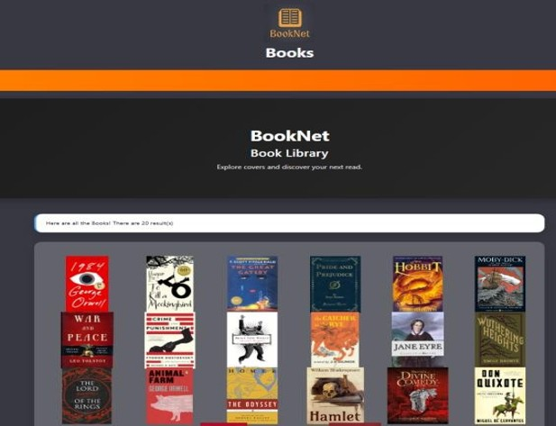
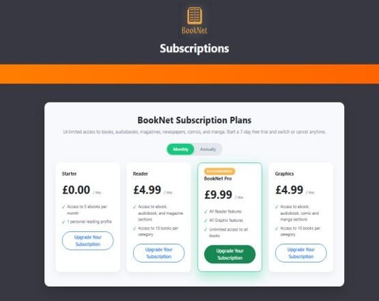
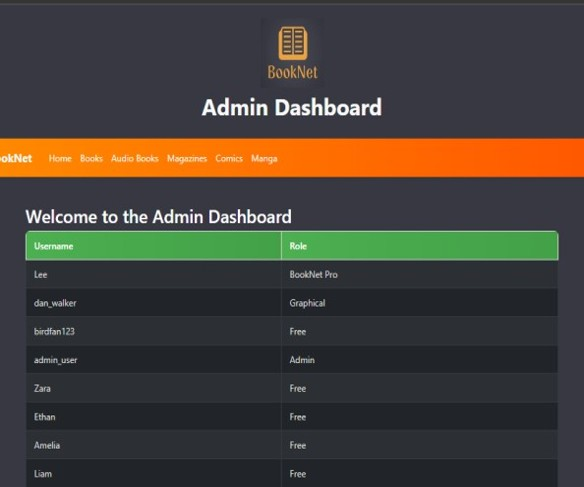

# BookNet - Digital Library with Paywall

A digital reading pllatform (books, manga, comics, magazines, audiobook) with free and premium  access tiers, built in a team of 5 during a two-week HackCamp at the University of Salford (Dec 2025) for a real client brief from ABL.

## Tech Stack
PHP · SQLite · JavaScript · HTML/CSS · MVC · XAMPP

## Features 
- User signup and login with hashed password (bcrypt)
- Paywall limiting free users and prompting them to upgrade
- Role-based access control (Free / Premium / Admin)
- Admin dashboard

## My Contribution
- Co-built the paywall and built role-based access control ('permission.php')
- Fixed a security gap where free users could bypass the paywall via direct URLs
- Built the books page and integrated the team's page into one system

## Screenshots

### Home Page

### Paywall

### Admin dashboard

## How to run
1. Install XAMPP and copy this folder into 'C:\xampp\htdocs\'
2. Start Apache in XAMPP
3. Open http://localhost/HackCamp-14/

## Team
Husnain Hussain, Max Hinchliffe, Oliver Smith, Enai Kilete, Miqdad Issa